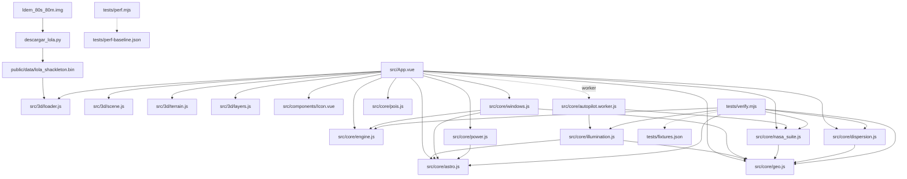

# Architecture

The repository is one Vue 3 application with three layers that never go the other way: data and physics modules in `src/core`, rendering in `src/3d`, and the planner shell in `src/App.vue` plus `src/style.css`. A Node test suite drives the physics layer directly, and a Tauri shell wraps the built frontend for desktop use.

## Module graph

No module in `src/core` imports Vue or Three.js, so every physics function can be called from Node.

## Root

| File | Purpose |
|------|---------|
| `index.html` | Shell document: `#app`, English language, theme colour, favicon |
| `vite.config.js` | Vue plugin and the Tailwind CSS v4 plugin; nothing else |
| `package.json` | `dev`, `build`, `preview`; no test script — tests are plain Node scripts |
| `descargar_lola.py` | Downloads a LOLA GDR product, crops 4000 × 4000 cells around the south pole, writes the header `rows, cols, mpc` followed by a float32 elevation array |
| `ldem_80s_80m.img` | The raw LOLA raster the script reads (not tracked for the app runtime) |
| `features.md` | Feature inventory and the assumptions table, kept in step with the code |
| `README.md` | Operator entry point: purpose, quick start, scoring model, limits |

## `src/`

| File | Purpose |
|------|---------|
| `main.js` | Mounts `App.vue` and imports `style.css` |
| `App.vue` | Planner shell. Holds the reactive state, talks to the worker, ranks candidates, draws the markers, fills every panel |
| `style.css` | Design tokens (colour, type scale, spacing), the panel system, the matrix table, the timeline grid, the radar and the overlays |

### `src/components/`

| File | Purpose |
|------|---------|
| `Icon.vue` | One inline SVG component; the size and stroke come from props |
| `icons.js` | The only icon geometry in the project: a single 24 × 24 grid, stroke 1.5, no fills |

### `src/core/`

| File | Exports |
|------|---------|
| `geo.js` | `pixelToGeo`, `geoToPixel`, `caidaCurvatura`, `pasoAzimut`, `R_LUNA`, `ROW_DIR`; no imports of its own |
| `astro.js` | `calcularEfemeridesMeeus`, `direccionesLunar`, `matriz_icrf_a_luna`, `lunaDesdeEstacion`, `RADIO_SOL`, `CONSTANTE_SOLAR`, `DELTA_T_S` |
| `engine.js` | `calculateSlopeDegrees`, `gradienteLocal`, `calculateHorizonProfile`, `calculateProjectedShadows`, `isTargetVisible`, `clasificarPendiente` |
| `illumination.js` | `iluminacionMensual` — per coarse cell Sun fraction over N days |
| `windows.js` | `visibilidadDiaria`, `buscar_ventanas_anuales` (the second is tested but not wired to the interface) |
| `power.js` | `calcular_potencia_electrica`, `telemetria_dsn`, `estacionActivaDSN`, `DSN_ESTACIONES`, `DSN_MIN_ELEVACION` |
| `nasa_suite.js` | `calculateRadiativeEquilibrium`, `evaluateGlideslopeCorridor`, `evaluateTrnFeasibility`, `evaluateLibrationRisk`, plus the approach constants |
| `dispersion.js` | `LANDING_ELLIPSE`, `sampleEllipse`, `scoreDispersion`, `ellipseOutline` — the landing ellipse and its survival score |
| `clock.js` | `advanceClock` — the planner clock arithmetic (1x, 60x, 3600x, hour and day rollover), pure so it can be tested without a browser |
| `pois.js` | `POIS` (25 sites) and `POI_TIPOS` — the single site catalogue |
| `autopilot.worker.js` | Worker entry: `ILLUMINATION` runs the monthly map, `AUDIT` runs slope, footprint, illumination sampling, non-maximum suppression and the glideslope filter |

### `src/3d/`

| File | Purpose |
|------|---------|
| `scene.js` | `initScene` — renderer, ACES tone mapping, camera with `fov 45`, OrbitControls, ambient, hemisphere and directional lights, 2048² shadow map refreshed only when the Sun moves |
| `loader.js` | `loadBinaryDEM` — reads the 12-byte header, validates the payload size against `rows × cols`, returns a `Float32Array` |
| `terrain.js` | `createTerrainMesh` — builds a plane from the DEM with a decimation stride of 4 (4000 → 1000 vertices per side) |
| `layers.js` | Builds the surface textures (shaded relief, elevation, slope risk, illumination) as `DataTexture` |
| `software.js` | `createSoftwareView` — column raycaster used when the browser exposes no WebGL2 context; same camera framing, layers, markers and picking as the GPU path |

## `tests/`

| File | Purpose |
|------|---------|
| `verify.mjs` | 14 sections of numerical checks; prints `TODO OK` or the failure count and exits non-zero |
| `perf.mjs` | Timings for the heavy passes against `perf-baseline.json` |
| `fixtures.json` | Skyfield + JPL DE421 reference values |
| `sfc-check.mjs` | Compiles the `App.vue` template, script and styles through `@vue/compiler-sfc` without starting Vite; useful when the bundler cannot run in the environment |
| `icon-check.mjs` | Every icon name used in the template, including dynamic bindings, exists in `src/components/icons.js` |
| `class-check.mjs` | Every static class in the `App.vue` template has a rule in `src/style.css` |
| `lang-check.mjs` | No pictographic emoji anywhere, no Spanish in visible interface text, and one single site count across the documentation |
| `doc-check.mjs` | Every symbol and every `src/` or `tests/` path the documentation mentions exists in the code |
| `relief-preview.mjs` | Renders the shaded-relief texture to `tmp/relief.png` so the terrain shading can be inspected without a browser |

## `src-tauri/`

| File | Purpose |
|------|---------|
| `main.rs`, `lib.rs` | Tauri entry point; the `run()` body logs only in debug builds |
| `tauri.conf.json` | Product name, window 1440 × 900 (minimum 1180 × 720), `frontendDist ../dist`, `devUrl http://localhost:5173` |
| `capabilities/default.json` | `core:default` permission set |
| `build.rs`, `Cargo.toml` | Crate `app` with library `app_lib` |
| `icons/` | Bundle icons |

## Conventions

- Physics constants live next to the model that uses them and are exported, so the tests and the interface read the same number.
- Every approximation is declared in the assumptions table of `features.md` with its value and its source; a model that cannot be defended is not added silently.
- The interface is English, sentence case, no glyphs in prose; semantic colour and one icon set carry meaning.
