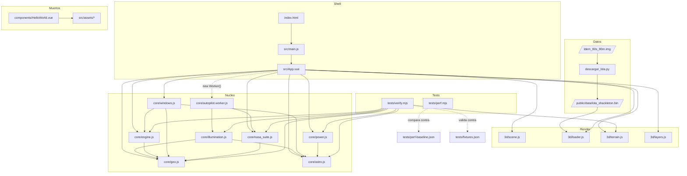

# Mapa de archivos y su uso

Grafo de dependencias de `l-sea` (Tauri + Vue 3 + Three.js). Las flechas van de *quien importa* a *lo que importa*.

## Que hace cada archivo

### Raiz

| Archivo | Uso |
|---|---|
| `index.html` | Punto de entrada HTML. Declara `
`, carga `src/main.js` y el favicon. |
| `vite.config.js` | Config de build: plugins `vue` y `tailwindcss`. Sin alias ni proxies. |
| `package.json` | Dependencias (`vue`, `three`) y scripts `dev` / `build` / `preview`. |
| `descargar_lola.py` | Herramienta offline: baja el LOLA GDR de 145 MB, recorta 4000x4000 celdas alrededor del polo sur y escribe `public/data/lola_shackleton.bin` (cabecera `rows, cols, mpc` + float32). No lo usa la app en runtime. |
| `ldem_80s_80m.img` | Insumo crudo de 145 MB que consume el script anterior. |
| `README.md` | Documentacion del modelo fisico, supuestos y limites. |

### Frontend (`src/`)

| Archivo | Uso |
|---|---|
| `main.js` | Monta Vue: `createApp(App).mount('#app')` e importa `style.css`. |
| `App.vue` | Nucleo de la app (82 KB). Estado global, UI completa, picking con raycast, orquestacion del worker, export del mission brief. Importa casi todo `core/` y `3d/`. |
| `style.css` | Estilos globales (Tailwind v4 entra por el plugin de Vite). |

### `src/3d/` — render

| Archivo | Uso |
|---|---|
| `scene.js` | `initScene(canvas)`: renderer, camara, luces, `OrbitControls`, bucle de animacion. |
| `loader.js` | `loadBinaryDEM(url)`: `fetch` + `ArrayBuffer` del `.bin`, devuelve `{dem, rows, cols, mpc}`. |
| `terrain.js` | `createTerrainMesh(...)`: `BufferGeometry` del terreno + `raycast` celda<->vertice (verificado en `verify.mjs`). |
| `layers.js` | Texturas GIS para las capas de mapa: elevacion, pendiente e iluminacion mensual. |

### `src/core/` — fisica (sin dependencias de UI, testeable en Node)

| Archivo | Uso |
|---|---|
| `geo.js` | Base geodesica: `pixelToGeo`, `geoToPixel`, `caidaCurvatura`, `pasoAzimut`, constantes (`R_LUNA`, `ROW_DIR`, deg/rad). No importa nada. |
| `astro.js` | Efemerides: serie de Meeus truncada, rotacion lunar IAU, `direccionesLunar`, `calcularEfemeridesMeeus`, `lunaDesdeEstacion`. Constantes `RADIO_SOL`, `CONSTANTE_SOLAR`, `DELTA_T_S`. |
| `engine.js` | Terreno y horizonte: pendiente, gradiente, perfil de horizonte 360 con curvatura, sombras proyectadas, `isTargetVisible`. Depende de `geo.js`. |
| `illumination.js` | `iluminacionMensual(...)`: mapa de fraccion de Sol a 30 dias con trazado de sombras. Depende de `geo.js` + `astro.js`. |
| `windows.js` | `visibilidadDiaria` / `buscar_ventanas_anuales`: ventanas de iluminacion por celda y fecha. Depende de `astro.js`, `engine.js`, `geo.js`. |
| `power.js` | EPS y DSN: `calcular_potencia_electrica`, `telemetria_dsn` (Madrid/Goldstone/Canberra), `estacionActivaDSN`. Depende de `astro.js`. |
| `nasa_suite.js` | Suite de aterrizaje CLPS: equilibrio radiativo, corredor de glideslope, viabilidad TRN (relieve medido en el DEM × curva solar supuesta) y riesgo de libracion. Depende de `geo.js`. |
| `autopilot.worker.js` | Web Worker del autopilot: coordina iluminacion + glideslope fuera del hilo principal y devuelve candidatos rankeados. |

### Tests

| Archivo | Uso |
|---|---|
| `verify.mjs` | `node tests/verify.mjs`. Valida el nucleo contra fixtures de Skyfield/JPL DE421, casos analiticos y un raycast sobre la malla. Sin dependencias. |
| `perf.mjs` | `node tests/perf.mjs`. Mide tiempos del nucleo y los compara con `perf-baseline.json`. |
| `fixtures.json` | Valores de referencia de las efemerides. |
| `perf-baseline.json` | Tiempos base para detectar regresiones. |

### Shell Tauri (`src-tauri/`)

| Archivo | Uso |
|---|---|
| `src/main.rs` | Entry point binario; llama a `app_lib::run()`. |
| `src/lib.rs` | `run()`: construye la app Tauri y activa el logger solo en debug. Sin comandos propios. |
| `tauri.conf.json` | Identidad de la app, ventana principal, `frontendDist` y comandos `before*`. |
| `capabilities/default.json` | Permisos IPC: `core:default` para la ventana `main`. |
| `build.rs` | `tauri_build::build()`. |
| `Cargo.toml` | Crate `app` (lib `app_lib`). |
| `icons/*` | Iconos que empaqueta el bundler. |

## Sin uso (restos del scaffold de Vite)

| Archivo | Nota |
|---|---|
| `src/components/HelloWorld.vue` | No lo importa nadie. |
| `src/assets/hero.png`, `vite.svg`, `vue.svg` | Solo los usa `HelloWorld.vue`. |

---

Grafo de simbolos (nivel funcion, interactivo): `graphify-out/graph.html`.
Verde nuevo tras editar codigo: `graphify update .`
